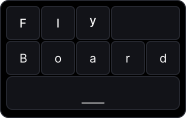

<p align="center">
	
</p>

# FlyBoard

FlyBoard is a compact desktop virtual keyboard. On Linux it creates a native
kernel `uinput` keyboard, so the currently focused application receives normal
keyboard events.

## Kiosk mode

Use the kiosk button to dock the keyboard across the bottom of the screen.
Drag the grip at the top to change its height; FlyBoard remembers that height
the next time kiosk mode is enabled. Exiting kiosk mode restores the previous
window size and position.

## Layout surface appearance

Open **Edit layouts & macros**, then choose a custom layout or duplicate a
built-in one. Its **Surface** setting offers **Solid** (the default) and
**Transparent**. The background color picker customizes the surface. Set
transparency from 1–100%. Select a key to customize its surface and transparency
independently; keys can also inherit the layout surface. These settings are
saved with the layout. Transparent native windows are enabled for the app.

## Ubuntu installation

> **📦 Important**: Use the `.deb` package (not `.AppImage`) for seamless Linux installation.
> The `.deb` automatically installs FlyBoard's udev rule and reloads it, allowing immediate access to `/dev/uinput`.

### Steps

1. **Download** the `.deb` package from [GitHub Releases](https://github.com/your-org/FlyBoard/releases)

2. **Install** the package:

```bash
sudo apt install ./flyboard_*.deb
```

3. **Restart your graphical session** (recommended):

> ℹ️ The package automatically reloads udev rules after installation. However, your session may need to restart
> to apply permission changes. If FlyBoard reports "Permission Denied" on first run, log out and back in.

4. **Verify setup** (optional, but helpful for troubleshooting):

```bash
ls -l /dev/uinput
getfacl /dev/uinput
```

You should see that your user has read and write access (`rw-`).

### Technical details

- The `.deb` package installs FlyBoard's udev rule at `/usr/lib/udev/rules.d/60-flyboard-uinput.rules`
- A post-installation script automatically reloads udev rules (no manual `udevadm` commands needed)
- FlyBoard does not add users to the `input` group (which can read physical input devices; a virtual keyboard requires less access)
- Physical key highlighting follows your session's existing access to `/dev/input/event*` keyboard devices

## Troubleshooting

### `UnexpectedMenuKind` error when compiling Tauri

This error occurs when newer Tauri menu macros are resolved alongside Tauri
2.10.2. The Cargo manifest pins the compatible Tauri and macro versions; keep
`src-tauri/Cargo.lock` with those changes.

From the repository root, verify the dependencies with:

```bash
cargo check --manifest-path src-tauri/Cargo.toml --locked
```

### "Permission Denied" error when starting FlyBoard

**Cause**: You haven't restarted your session after installing the `.deb`.

**Fix**:

1. Log out and back in (or reboot your system)
2. Try FlyBoard again

### "Cannot find /dev/uinput"

**Cause**: The Linux kernel module isn't loaded.

**Fix**:

```bash
sudo modprobe uinput
```

### Using AppImage or developing FlyBoard

If you downloaded the `.AppImage` or are developing FlyBoard, you need to manually install the udev rule:

```bash
sudo install -Dm644 src-tauri/resources/60-flyboard-uinput.rules /usr/lib/udev/rules.d/60-flyboard-uinput.rules
sudo udevadm control --reload-rules
sudo udevadm trigger --action=change --subsystem-match=misc --sysname-match=uinput
```

Then restart your graphical session. The app displays diagnostics in its window if `/dev/uinput` is unavailable.

## Development: Build and run from source

### Prerequisites

If building from source, you need to install the udev rule first:

```bash
sudo install -Dm644 src-tauri/resources/60-flyboard-uinput.rules /usr/lib/udev/rules.d/60-flyboard-uinput.rules
sudo udevadm control --reload-rules
sudo udevadm trigger --action=change --subsystem-match=misc --sysname-match=uinput
```

### Build commands

```bash
pnpm install
pnpm tauri:linux dev          # Development run
pnpm tauri:linux:build        # Build .deb and .AppImage
```

### Important notes

- **Close FlyBoard before rebuilding an AppImage**. Linux cannot replace an executable while it is running (`Text file busy` error).
- To identify a process holding a generated artifact:

```bash
fuser -v src-tauri/target/release/bundle/appimage/*.AppImage
```

## Window behavior on Linux

GNOME Wayland does not provide ordinary desktop applications with a guaranteed
always-on-top layer. When FlyBoard starts in a Wayland session and XWayland is
available, it automatically uses XWayland so it can stay above normal
application windows without taking focus from the active input target.

To force native Wayland, launch FlyBoard with `GDK_BACKEND=wayland`. The
virtual keyboard remains functional, but the compositor can reject its
always-on-top request.
